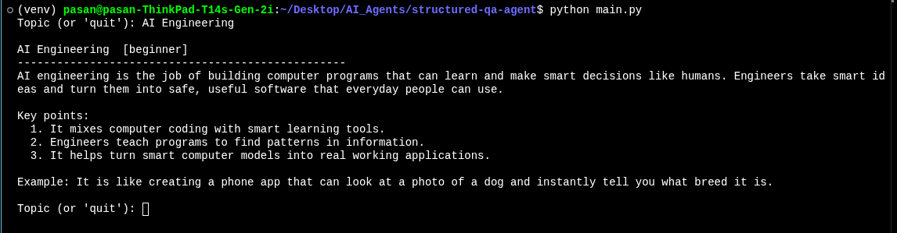

# Structured QA Agent

A small command-line agent that explains any topic to a complete beginner and returns the answer in a strict, structured format instead of free-form prose.

The agent is built with [LangChain](https://python.langchain.com/), Google's Gemini models, and Pydantic. It takes a topic as input, asks a large language model to act as a patient teacher, and forces the response into a predictable schema containing a title, a short summary, exactly three key points, a difficulty level, and a concrete everyday example.

## What the Agent Does

Given a topic such as `Photosynthesis`, the agent returns:

- **Title** - a short, clear title for the topic.
- **Summary** - exactly two simple sentences explaining the topic.
- **Key points** - exactly three short takeaways.
- **Difficulty** - one of `beginner`, `intermediate`, or `advanced`.
- **Example** - one everyday analogy that makes the idea concrete.

Because the response is validated against a Pydantic model, the output is reliable enough to display, store, or pass to another program without parsing free text.

## How It Works

The flow is a single LangChain chain:

```
User topic -> ChatPromptTemplate -> Gemini LLM -> with_structured_output(TopicSummary) -> TopicSummary
```

1. **Prompt** (`chain.py`)
   A `ChatPromptTemplate` sets a system message that tells the model to behave like a patient teacher who avoids jargon, plus a human message with the topic to explain.

2. **Model** (`chain.py`)
   `ChatGoogleGenerativeAI` is configured with `model="gemini-3.5-flash"` and `temperature=0` for consistent, deterministic answers.

3. **Structured output** (`chain.py` + `schemas.py`)
   `llm.with_structured_output(TopicSummary)` binds the model to a Pydantic schema. The model must return data that matches the schema, including the allowed difficulty values.

4. **CLI** (`main.py`)
   An interactive loop reads topics from the terminal, invokes the chain, prints a formatted result, and exits on `quit` or `exit`.

5. **Tests** (`test_topics.py`)
   A lightweight test script runs the chain against a fixed list of topics, checks that the result is a `TopicSummary` with exactly three key points, and reports a pass/fail summary.

## Project Structure

```
.
├── chain.py          # Prompt, model, and structured-output chain
├── main.py           # Interactive command-line interface
├── schemas.py        # Pydantic schema for structured answers
├── test_topics.py    # Batch test script over sample topics
├── requirements.txt  # Python dependencies
├── .env              # API key (not committed)
├── .gitignore        # Ignores venv, cache, etc.
└── README.md
```

## Requirements

- Python 3.9+
- A Google AI Studio / Gemini API key

Dependencies (`requirements.txt`):

- `langchain`
- `langchain-google-genai`
- `python-dotenv`
- `pydantic`

## Setup

1. Clone the repository and enter the directory:

   ```bash
   git clone <repo-url>
   cd structured-qa-agent
   ```

2. Create and activate a virtual environment:

   ```bash
   python -m venv venv
   source venv/bin/activate
   ```

3. Install dependencies:

   ```bash
   pip install -r requirements.txt
   ```

4. Add your Gemini API key to `.env`:

   ```env
   GOOGLE_API_KEY=your_api_key_here
   ```

   `chain.py` calls `load_dotenv()` on import, so the key is picked up automatically.

## Usage

Run the interactive agent:

```bash
python main.py
```

Example session:

```
Topic (or 'quit'): photosynthesis

Photosynthesis  [beginner]
--------------------------------------------------
Photosynthesis is how plants use sunlight to make their own food.
They turn light, water, and air into sugar and release oxygen.

Key points:
  1. Plants capture sunlight with a green pigment called chlorophyll.
  2. Water and carbon dioxide are converted into sugar.
  3. Oxygen is released as a by-product.

Example: Think of a plant as a tiny solar-powered kitchen that makes its own meals.

Topic (or 'quit'): quit
Bye!
```

The loop handles empty input gracefully and prints an error message if a request fails instead of crashing.

### Example Output



## Running the Tests

Run the full batch of sample topics:

```bash
python test_topics.py
```

Run only the first `N` topics:

```bash
python test_topics.py 3
```

The script prints `PASS` or `FAIL` for each topic and a final score. It sleeps briefly between requests to stay within API rate limits. A passing result satisfies three checks:

1. The call succeeds without an exception.
2. The result is a `TopicSummary` instance.
3. The result contains exactly three key points.

Expected output:

```
PASS  Photosynthesis
PASS  Binary search
...
10/10 passed
```

## The `TopicSummary` Schema

Defined in `schemas.py`:

| Field        | Type                                            | Description                                      |
| ------------ | ----------------------------------------------- | ------------------------------------------------ |
| `title`      | `str`                                           | Short, clear title of the topic                  |
| `summary`    | `str`                                           | Two simple sentences explaining the topic        |
| `key_points` | `list[str]`                                     | Exactly three short key points                   |
| `difficulty` | `Literal["beginner", "intermediate", "advanced"]` | How hard the topic is to learn                   |
| `example`    | `str`                                           | One everyday example that makes the idea concrete |

To change the output shape, edit this model. The chain automatically enforces the new schema, and `main.py` will need matching display logic.

## Customization

- **Change the model**: edit the `model` argument in `chain.py`. The current model is `gemini-3.5-flash`.
- **Change the teaching style**: edit the system message in `chain.py`.
- **Add fields**: extend `TopicSummary` in `schemas.py` and update `show()` in `main.py`.
- **Change test topics**: edit the `TOPICS` list in `test_topics.py`.

## Troubleshooting

- **`GOOGLE_API_KEY` missing**: make sure `.env` exists and contains a valid key, or export the variable in your shell.
- **Model not found / unavailable**: Google periodically retires model names. Check available models and update the `model` string in `chain.py`.
- **Timeouts or hanging requests**: some model endpoints can be slow or unavailable. Try another Gemini model such as `gemini-3.5-flash` or `gemini-3-flash-preview`.
- **Rate limits**: increase the `time.sleep(...)` delay in `test_topics.py` or test fewer topics at once.
- **Import errors**: ensure the virtual environment is activated and `pip install -r requirements.txt` has completed.
